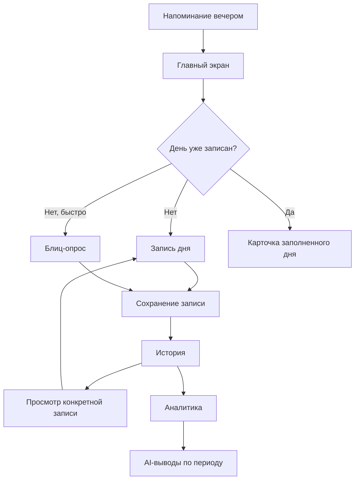
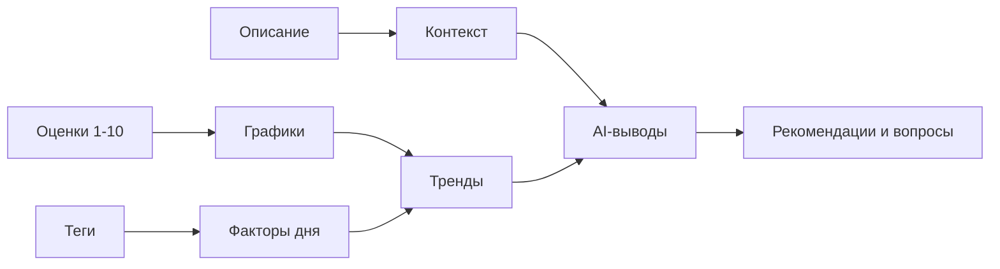

# RhythmDay

Kotlin Multiplatform starter for RhythmDay.

## Project Structure

- Android app entrypoint: `composeApp/src/androidMain`
- Shared Compose/KMP code: `composeApp/src/commonMain`
- iOS app shell: `iosApp`
- Desktop app entrypoint: `composeApp/src/desktopMain`

`iosApp` нужен как Xcode/SwiftUI-оболочка: `iosMain` собирает общий Kotlin/Compose framework, но само iOS-приложение, bundle id, signing, assets и SwiftUI entrypoint живут в iOS app target.

## Tech Stack

- Kotlin Multiplatform
- Compose Multiplatform
- Compose Material 3
- Android Gradle Plugin 8.13.2
- Gradle version catalog

## Product Structure
# Ритм дня: схема работы приложения

## 1. Главная идея

`Ритм дня` - личный дневник состояния, который помогает человеку не просто "писать про день", а замечать закономерности между сном, энергией, настроением, стрессом, социальной нагрузкой и общей оценкой дня.

Приложение должно решать три задачи:

1. Быстро фиксировать состояние прожитого дня.
2. Показывать историю и динамику без ручного анализа.
3. Помогать пользователю видеть повторяющиеся факторы и мягко принимать решения на будущее.

MVP не должен быть медицинским инструментом, трекером продуктивности или сложной системой самоанализа. Его первая задача - сделать регулярную запись дня достаточно простой, чтобы пользователь действительно возвращался.

## 2. Основной цикл пользователя



В нормальном сценарии пользователь вечером получает напоминание, открывает главный экран, заполняет оценки и при желании добавляет теги/описание. После сохранения запись попадает в календарь, список записей месяца, графики и будущие AI-выводы.

## 3. Главные сущности

### Запись дня

Одна запись привязана к конкретной дате и содержит:

- дату;
- общую оценку дня;
- 7 параметров состояния;
- теги дня;
- текстовое описание;
- в будущем - голосовую диктовку, вложения или авто-транскрибацию;
- служебные данные: время создания, время обновления, источник заполнения (`полная запись` или `блиц`).

### Месяц

Месяц нужен для истории:

- календарь с цветовой оценкой дней;
- список записей выбранного месяца;
- переход в конкретную запись;
- базовые месячные графики.

### Период

Период нужен для аналитики:

- неделя;
- месяц;
- выбранный диапазон дат.

Период объединяет записи и позволяет считать средние значения, динамику, лучшие/тяжелые дни и связи между параметрами.

## 4. Параметры записи

Все параметры оцениваются по шкале `1-10`.

| Параметр | Что спрашиваем | Зачем нужен |
| --- | --- | --- |
| Общая оценка дня | Как в целом прошел день? | Главный итог дня. По нему строится цвет календаря, быстрые списки, главный график и сравнение периодов. |
| Энергия | Сколько было сил? | Показывает ресурсность дня. Помогает замечать спад после плохого сна, перегруза или стресса. |
| Настроение | Какое было эмоциональное состояние? | Отдельно фиксирует эмоциональный фон, который может не совпадать с энергией или самочувствием. |
| Самочувствие | Как чувствовало себя тело? | Нужен для учета физического состояния: усталость, боль, тонус, болезнь, телесный дискомфорт. |
| Качество сна | Насколько сон восстановил? | Один из ключевых факторов, который часто влияет на энергию, ясность ума и стресс. |
| Ясность ума | Насколько легко думалось? | Фиксирует когнитивное состояние: фокус, скорость мышления, память, способность решать задачи. |
| Стресс | Насколько напряженным был день? | Показывает нагрузку. Важно: для стресса высокая оценка означает не "лучше", а "больше напряжения". |
| Социальность | Сколько было ресурса на людей? | Помогает отделять качество общения и социальный ресурс от общего настроения. |

### Формула общей оценки дня

Общая оценка дня должна считаться автоматически из параметров состояния. Параметры вводятся по шкале `1-10`, но итоговый день оценивается по шкале `0-10`, где `0` - крайне плохой день, а `10` - лучший день вообще.

Поэтому перед расчетом параметры нормализуются из `1-10` в `0-10`.

Нормализация обычных параметров:

```text
normalized = (value - 1) * 10 / 9
```

Нормализация стресса:

```text
stressScore = (10 - stress) * 10 / 9
```

Формула:

```text
dayScore =
  normalizedSleep * 0.18 +
  normalizedEnergy * 0.17 +
  normalizedMood * 0.16 +
  normalizedFocus * 0.15 +
  normalizedBody * 0.14 +
  stressScore * 0.12 +
  normalizedSocial * 0.08
```

Итог округляется до одного знака после запятой.

Крайние случаи:

- если все позитивные параметры равны `1`, а стресс равен `10`, итоговая оценка будет `0`;
- если все позитивные параметры равны `10`, а стресс равен `1`, итоговая оценка будет `10`.

Почему такие веса:

- `Качество сна` получает самый большой вес, потому что часто влияет сразу на энергию, ясность ума, настроение и стресс.
- `Энергия`, `настроение` и `ясность ума` почти напрямую формируют субъективное ощущение дня, поэтому их веса близки друг к другу.
- `Самочувствие` важно, но иногда человек может считать день хорошим даже при среднем физическом состоянии.
- `Стресс` влияет заметно, но идет через обратную шкалу: высокий стресс снижает итог.
- `Социальность` имеет меньший вес, потому что для разных людей этот фактор менее универсален: интроверту и экстраверту он может значить разное.
- Это стартовая формула MVP, а не окончательная истина. Позже веса можно персонализировать по данным пользователя или дать настройку вручную.

## 5. Почему не один общий балл

Одна общая оценка удобна, но она не объясняет причину дня. Например:

- день может быть хорошим по настроению, но плохим по энергии;
- сон может быть хорошим, но стресс высоким;
- социальность может быть низкой не из-за плохого настроения, а из-за усталости;
- самочувствие может просесть, но когнитивная ясность остаться нормальной.

Поэтому общая оценка отвечает на вопрос `как я оцениваю день в целом`, а параметры отвечают на вопрос `из чего этот день состоял`.

## 6. Цветовая логика

Цвет используется как быстрый сигнал, но не как диагноз.

| Уровень | Диапазон | Смысл |
| --- | --- | --- |
| Хороший | `8-10` | День был ресурсным или явно положительным. |
| Средний | `5-7.9` | Нормальный, смешанный или нейтральный день. |
| Тяжелый | `1-4.9` | День требовал больше восстановления или внимания. |

Цвет применяется в:

- календаре;
- списке записей месяца;
- карточке конкретной записи;
- карточке последней записи;
- будущих сводках аналитики.

Для стресса используется обратная трактовка: высокий стресс снижает итоговую оценку и должен окрашиваться как тяжелое состояние.

## 7. Экраны MVP

### Главный экран

Назначение: быстро понять, записан ли день, и дать короткий путь к действию.

Содержит:

- дату;
- карточку `Как прошел день?`, если день не заполнен;
- карточку заполненного дня, если запись уже есть;
- краткую сводку недели;
- последнюю запись;
- короткий AI-сигнал.

Главный экран не должен превращаться в дашборд. Его задача - действие сегодня и быстрый контекст.

### Запись дня

Назначение: основное заполнение дневника.

Содержит:

- 7 слайдеров параметров;
- теги дня;
- описание дня;
- кнопку сохранения.

Запись должна быть достаточно полной, но не перегруженной. Пользователь может сохранить только оценки, а текст и теги добавить позже.

### Блиц-опрос

Назначение: быстрый сценарий для дней, когда нет сил заполнять полную форму.

Он спрашивает параметры по одному. Это полезно не потому, что он всегда быстрее полной формы, а потому что снижает когнитивную нагрузку: пользователь видит только один вопрос за раз.

### История

Назначение: просмотр прошлого.

Содержит:

- полноценный календарь с переключением месяцев;
- цветовую отметку заполненных дней;
- список записей выбранного месяца;
- переход в конкретную запись.

### Просмотр записи

Назначение: посмотреть конкретный день.

Содержит:

- дату;
- общую оценку и статус дня;
- теги;
- все параметры;
- комментарий;
- переход к редактированию.

### Аналитика

Назначение: увидеть динамику и сравнить параметры.

Содержит:

- периоды: неделя, месяц, выбранный период;
- основной график;
- режим одного или нескольких выбранных параметров;
- режим мини-графиков по всем параметрам;
- переход из точки графика в запись дня.

### AI-отчет

Назначение: перевести данные в понятные выводы.

В MVP AI должен анализировать выбранный период и выдавать:

- повторяющиеся факторы;
- возможные связи между параметрами;
- мягкие рекомендации;
- вопросы для самонаблюдения.

AI не должен ставить диагнозы, давать медицинские утверждения или делать жесткие выводы о психическом здоровье.

## 8. Как данные превращаются в пользу



Пример:

- пользователь ставит `сон 4`, `энергия 4`, `ясность ума 3`, `стресс 8`;
- календарь показывает тяжелый день;
- аналитика показывает связь плохого сна и падения ясности;
- AI может сформулировать: `В дни с низким качеством сна у тебя чаще проседает ясность ума и растет стресс. Возможно, стоит отмечать время отхода ко сну или вечернюю нагрузку`.

## 9. Минимальная модель данных

```text
DayEntry
- id
- date
- score
- metrics
  - energy
  - mood
  - body
  - sleep
  - focus
  - stress
  - social
- tags[]
- comment
- source: full | blitz
- createdAt
- updatedAt
```

## 10. Что важно для MVP

В MVP обязательно:

- создать запись дня;
- сохранить общую оценку и 7 параметров;
- добавить теги;
- добавить текстовое описание;
- открыть историю;
- перейти в запись из календаря/списка/графика;
- посмотреть графики за неделю, месяц и период;
- увидеть простые AI-выводы по данным.

Можно отложить:

- настоящую авторизацию;
- сложную синхронизацию;
- глубокую персонализацию AI;
- медицинские рекомендации;
- экспорт в сложные форматы;
- вложения и фото;
- полноценную голосовую транскрибацию, если нет готового системного решения.

## 11. Принцип продукта

Приложение должно быть спокойным и бережным. Оно не должно давить на пользователя, ругать за пропуски или превращать жизнь в KPI.

Хорошая формула:

`Записал день -> увидел ритм -> понял фактор -> сделал маленькую корректировку`.

